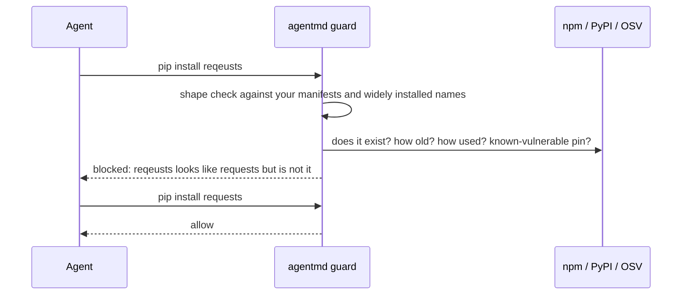

<div align="center">
<picture>
  <source media="(prefers-color-scheme: dark)" srcset="assets/logo-dark.png">
  
</picture>

# Agent.md

## The files your agents follow, checked every time.

Your AI coding agent reads `CLAUDE.md`, `AGENTS.md`, rules, skills, hooks and MCP configs before it reads a line of your code, then does what they say.<br>
Agent.md **checks** them (26 deterministic checks), **keeps** the hard rules through compaction, **turns** "never" lines into real deny rules, and **guards** every install the agent runs.<br>
Any repo. Ten seconds. No account. Nothing uploaded.

```bash
npx activate-agentmd audit your/repo
```

[](https://www.npmjs.com/package/activate-agentmd)
[](#-agentmd-lint-the-26-checks)
[](LICENSE)
[](https://nodejs.org)
[](https://discord.gg/AmukvXywRr)
[](CONTRIBUTING.md)
[](https://github.com/Aaditya1273/Agent.md/issues?q=is%3Aissue+is%3Aopen+label%3Ahacktoberfest)


**[The problem](#-the-problem) · [What it does](#-what-agentmd-does) · [Every time](#-every-time-not-once) · [Quick start](#-quick-start) · [Why it's different](#-why-its-different) · [Research](#-what-the-research-says--and-what-we-built) · [CI](#-enforce-it-in-ci) · [FAQ](#-faq)**


</div>

### What it finds

Real output, on a small example repo:

```text
  Agent context audit  acme-app
  2 files an agent reads · ~52 tokens loaded on every prompt

     1  secrets in files the agent reads
     1  prompt-injection signals
     1  dangerous patterns in 1 skill script
     1  references to files that no longer exist
     1  formatting rules a formatter already enforces  auto-fixable

  ERROR   .claude/skills/deploy/scripts/run.sh:2  skill-payload
          Downloads code and pipes it straight into a shell.
  ERROR   CLAUDE.md:4  secret
          Looks like an Anthropic API key. Instruction files are sent to the model on every session.
  ERROR   CLAUDE.md:6  injection
          An HTML comment carries an instruction. GitHub hides comments from reviewers but the agent reads them.
  WARNING CLAUDE.md:3  stale-reference
          `src/auth/middleware.ts` does not exist in this repository. The agent will look for it and guess.
```

| Command | What it does |
| --- | --- |
| `npx activate-agentmd audit owner/repo` | Check any public GitHub repo, without cloning it |
| `npx activate-agentmd lint` | Check your own repo. Exits non-zero in CI; SARIF for code scanning |
| `npx activate-agentmd init` | Attach to the agents in this project, once: compile the "never" lines into Claude Code and Codex controls, install the hooks, and attach the runtime guard to Claude Code |
| `npx activate-agentmd demo` | Two minutes, offline: the guard pauses a production volume delete, signs the refusal, and refuses what an `AGENTS.md` forbids, citing the line |
| `npx activate-agentmd lint --fix` | Delete what only costs tokens, and tell the agent to follow the code when a file drifted from it |
| `npx activate-agentmd guard --install` | Block typosquats, untrusted indexes and vulnerable pins before the agent's `pip` / `npm install` runs |
| `npx activate-agentmd pin --install` | Keep the hard rules in context through compaction: they come back after every `/compact` and resume |
| `npx activate-agentmd enforce --write` | Turn "never do X" lines into permission deny rules, and see which rules are still prose only |
| `npx activate-agentmd learn` | The corrections you keep giving your agent, proposed as rules |
| `npx activate-agentmd cost` | What your always-on context costs per developer per month, and what `--fix` gives back |
| `npx activate-agentmd sbom --out bom.json` | Context bill of materials (CycloneDX 1.6): every file, skill, script, hook, MCP server and grant an agent loads, hashed |
| `npx activate-agentmd ci --write` | All of it on every pull request, as one GitHub Actions workflow |
| `npx activate-agentmd init --presets` | Optional: version notes and engineering standards for your exact stack |

It reads `CLAUDE.md`, `AGENTS.md`, `GEMINI.md`, Cursor and Copilot rules, every `SKILL.md` and the scripts beside it, subagents, hooks, memory files and MCP configs, for **Claude Code, Cursor, Codex, Copilot and Gemini CLI**. Free, open source, runs locally. Precision first: findings on the instruction files of 146 real-world repositories, every reference finding checked by hand, plus 4,292 registry files and 272 skill scripts; precision is re-checked on 72 of those repositories before each release. What it cannot see: [docs/KNOWN-LIMITS.md](docs/KNOWN-LIMITS.md).

---

## 🔥 The problem

Every coding agent reads a rules file first, on every prompt, and trusts it more than your code. Nobody reviews those files like code, and nothing enforces what they say.

### 1. They go stale, and the agent follows the stale file

In 320 runs across 40 projects, **90.1% of agent choices followed an outdated instruction file over the existing code**. Claude Code noticed the conflict in 79 of 80 runs and followed the file anyway. One sentence telling the agent to prefer the code raised code-following from 4.2% to 91.4% ([arXiv 2610.30571](https://arxiv.org/abs/2610.30571)).

### 2. The rules vanish, and "never" is only a sentence

- After a session compacts, violations of the project's own rules go **from 0% to 30–59%** ([arXiv 2606.22528](https://arxiv.org/abs/2606.22528)); the request to fix it upstream was closed *not planned* ([claude-code#24460](https://github.com/anthropics/claude-code/issues/24460)).
- In 481 public `CLAUDE.md` files, only **4.4–16% of security rules have a control that enforces them** ([arXiv 2608.23550](https://arxiv.org/abs/2608.23550)). "Never force-push" is advice until something refuses the command.

### 3. They are an unguarded attack surface

- **~0.7% of public agent instruction files contain a live credential**, mostly pasted by hand ([Radware, Aug 2026](https://www.radware.com/blog/the-new-env-measuring-credential-leakage-in-ai-agent-instruction-files/)), and mainstream secret scanners don't watch these files.
- **Shared rule files make agents install look-alike packages** with 79% success across 8 agents and 13 models ([arXiv 2610.09264](https://arxiv.org/abs/2610.09264)); editing only a README or requirements file makes agents pull from attacker indexes ([Microsoft, arXiv 2607.15143](https://arxiv.org/abs/2607.15143)).
- **Rule files are a working prompt-injection channel** ([Aletheia, 2026](https://arxiv.org/abs/2609.39678)); skill scanners stop at `SKILL.md`, and every one tested was bypassed ([CSA / Trail of Bits](https://labs.cloudsecurityalliance.org/research/csa-research-note-ai-agent-skill-scanner-bypass-20260610-csa/)).

### 4. They bloat, and bloat costs accuracy

- Agent instruction files **grow +226% over their lifetime**, and noisy instructions **cut instruction-following by 24 points** ([arXiv 2608.11095](https://arxiv.org/abs/2608.11095)).
- **91 of the 100 most-starred repos** have at least one configuration smell: leaked lint rules, bloat, dead references, contradictions, never-edited `/init` output ([arXiv 2606.15828](https://arxiv.org/abs/2606.15828)).

> **The fix:** check every file the agent reads like you check code, keep the rules in context, turn the "never" lines into controls, and gate the installs. Every time, not once.

---

## 💊 What Agent.md does

| | Feature | The pain it removes |
| --- | --- | --- |
| 🔒 | **`lint` / `audit`**: 26 deterministic checks on every file an agent reads: leaked keys, prompt injection, invisible Unicode, hidden HTML-comment instructions, look-alike packages, untrusted install sources, unpinned MCP servers, shell-wide permission grants, contradictions, file-vs-code drift, duplicate skills, bloat, dead references, stale pins. `--fix` deletes what only costs tokens. Exit 1 in CI; SARIF for code scanning. | Secrets, injected instructions and poisoned setup steps reaching the model; files that drifted from the code |
| 📌 | **`pin`**: a Claude Code `SessionStart` hook that re-injects the hard rules after every `/compact` and resume, inside a token budget you set. | Rules that disappear halfway through a long session |
| ⛔ | **`enforce`**: compiles one-reading "never" lines (force-push, push to main, `rm -rf`, editing `.env`, `sudo`, publish, `terraform`, `kubectl`, `curl \| sh` …) into `permissions.deny`, and reports what stays prose. `--check` fails CI on a gap. | "Never" that nothing enforces |
| 🛡 | **`guard`**: a pre-install gate for the agent's own `pip` / `npm` / `uv` commands: typosquats, separator confusion, untrusted `--extra-index-url` and registries, plain-HTTP indexes, hidden directives in requirements files, known-vulnerable pins (OSV). | Agents install from an untrusted index almost unconditionally |
| 🧠 | **`learn`**: reads your own local session logs for the corrections you keep giving ("use pnpm", "don't touch the migrations") and proposes them as rules. Nothing is kept without you. | Repeating yourself to the agent every day |
| 💸 | **`cost`**: what your always-on context costs per developer per month, per agent. `--budget` fails a PR that pushes it over your limit. | Context that only grows |
| 📋 | **`sbom`**: a context bill of materials in CycloneDX 1.6: every instruction file, rule, skill and script, subagent, hook, MCP server and permission grant, hashed. | "What was this agent loading?" has no answer today |
| ⇅ | **Version pins + checks**: reads the majors you actually run and puts their breaking changes in the agent's context; 15 deterministic checks across 13 libraries catch the old API in the diff. | Deprecated code that compiles, passes review, and breaks later |
| ✍️ | **Signed context bundles**: sign the exact set of instruction files your team approved with your own Ed25519 key. CI fails on any change. | Unreviewed rule changes |
| 📚 | **300+ engineering standards, on demand**: security, backend, database, frontend, API, testing, DevOps, motion design and more, loaded only when the agent works in that area. | Re-writing the same 400-line rules file in every repo |

---

## 🔁 Every time, not once

A linter you run once is a one-time fix. These files are read on every prompt, so Agent.md sits on the moments they fail:

```mermaid
flowchart LR
    S([Session start / compaction]) -- pin re-injects the hard rules --> A[Your agent]
    I([Every install the agent runs]) -- guard blocks look-alikes and bad indexes --> A
    N(["Every 'never' line"]) -- enforce compiles it to a deny rule --> A
    C([Every correction you repeat]) -- learn proposes it as a rule --> F[(CLAUDE.md · AGENTS.md · rules · skills)]
    F -- read on every prompt --> A
    P([Every pull request]) -- lint · enforce --check · cost --budget --> F
    R([Every dependency bump]) -- stale pins · drift · dead paths --> F
```

| Moment | Command | What happens |
| --- | --- | --- |
| Session start, `/compact`, resume | `pin --install` | the hard rules come back into context |
| The agent runs `pip install` / `npm install` | `guard --install` | look-alikes, untrusted indexes and vulnerable pins are blocked, with the reason |
| You write "never …" | `enforce --write` | it becomes a deny rule the harness applies |
| You correct the agent twice | `learn` | the correction is proposed as a rule |
| A pull request touches the files | `ci --write` | lint, enforce coverage and a token budget, in one workflow |
| A dependency or a path changes | `lint` | stale pins, drift and dead references fail the check |

---

## 🚀 Quick start

**1. Check every file your agent reads**: works on any repository, nothing to install first

```bash
npx activate-agentmd lint
```

```
  ERROR   CLAUDE.md:14  secret
          Looks like an Anthropic API key. Instruction files are sent to the model on every session — rotate it, then read it from the environment.
  ERROR   .cursor/rules/deploy.mdc:3  injection
          An HTML comment carries an instruction. GitHub hides comments from reviewers but the agent reads them.
  WARNING CLAUDE.md:1  stale-pins
          The version pins in the agentmd block do not match the dependencies this project now runs.

  2 errors, 1 warning across 6 instruction files
```

**2. Gate every install the agent runs**

```bash
npx activate-agentmd guard --install
```

<div align="center">

</div>

**3. Keep the rules, and make "never" real**

```bash
npx activate-agentmd pin --install      # hard rules survive /compact and resume
npx activate-agentmd enforce --write    # "never" lines become permissions.deny
```

```text
  Enforcement  6 hard rules · 5 prohibitions · 4 enforceable · 0 enforced · 2 left to the model

  ! prose only CLAUDE.md:3  Never force-push.
               force pushes: Bash(git push --force:*), Bash(git push -f:*), Bash(git push --force-with-lease:*)
  ! prose only CLAUDE.md:4  Never edit `.env`.
               edits to `.env`: Edit(./.env)

  ! 9 deny rules would make the prose above enforced. `agentmd enforce --write` adds them to .claude/settings.json.
```

**4. See what your context costs, and what it loads**

```bash
npx activate-agentmd cost
npx activate-agentmd sbom --out bom.json
```

<div align="center">

</div>

**5. Detect the stack, pin breaking changes, install standards**

```bash
npx activate-agentmd init --presets
npx activate-agentmd link
```

```
  ✓ Next.js                  package.json (next)
  ✓ PostgreSQL               package.json (pg)
  ⇅ Next.js 16               node_modules (next 16.0.3)    (version pin)
  ⇅ Prisma 7                 package.json (@prisma/client ^7.0.0)

Recommended packages for claude:
  Security       authentication, owasp, sql-injection
  Database       postgres, prisma, indexes, migration
Install these? [Y/n]
```

`link` writes a managed block into whichever of `CLAUDE.md`, `AGENTS.md`, `.cursor/rules`, `GEMINI.md` and `copilot-instructions.md` your tools read. Commit `.agentmd/` and the whole team gets the same rules.

<div align="center">

</div>

**6. Check a diff: deterministic, offline, zero tokens**

```bash
npx activate-agentmd review --fast --fail-on=high
```

<div align="center">

</div>

**Or try it in the browser in 10 seconds** at **[agentmd.tech/inspect](https://agentmd.tech/inspect)**: drop a `package.json` to see every major your agent will get wrong, or paste a `CLAUDE.md` to check it. Nothing is uploaded.

<a href="https://agentmd.tech/connect"></a>

---

## 🧪 Try to sneak something past it

| Attempt | What Agent.md does |
| --- | --- |
| Paste an API key into `CLAUDE.md` | `secret` error; the key is never echoed; the PR check goes red |
| Hide an instruction in an HTML comment | `injection` error (GitHub hides comments from reviewers, the agent reads them) |
| Add `pip install reqeusts` to a setup step | `package-swap` error in lint; `guard` blocks it at run time; `--online` asks PyPI whether the name exists |
| Point installs at `--extra-index-url http://…` | `install-source` error; `guard` blocks it |
| Write "never force-push" and hope | `enforce` adds `Bash(git push --force:*)` to `permissions.deny`; the harness refuses it |
| Run a long session until `/compact` drops the rules | `pin` re-injects them on `SessionStart` |
| Move a file and leave `CLAUDE.md` pointing at the old path | `stale-reference`, with where the file is now |
| Tell the agent "use 4 spaces" when `.editorconfig` says tabs | `code-drift`; `--fix` adds the precedence sentence |
| Ship two skills with the same name in one folder | `skill-conflict`: the agent would load one at random |
| `npx -y some-mcp-server@latest` in an MCP config | `mcp-unpinned` |
| Edit an approved instruction file without sign-off | `bundle verify` fails CI |
| Grow the always-on file a little every week | `accretion` reads git history; `cost --budget` fails the PR that crosses your limit |

---

## 🧭 Why it's different

| | Agent.md | Hand-written `CLAUDE.md` | Skills marketplaces | Docs retrieval (Context7) | Code review bots |
| --- | :--: | :--: | :--: | :--: | :--: |
| Lints `CLAUDE.md` / `AGENTS.md` / rules / skills for secrets, injection and drift | ✅ 26 checks | ❌ | ⚠️ `SKILL.md` only | ❌ | ❌ |
| Rules survive compaction | ✅ `pin` | ❌ | ❌ | ❌ | ❌ |
| "Never" lines become enforced controls | ✅ `enforce` | ❌ | ❌ | ❌ | ❌ |
| Gates the agent's own installs | ✅ `guard` | ❌ | ❌ | ❌ | ❌ |
| Breaking changes for *your* installed majors, in context before the agent writes | ✅ | ✋ by hand | ❌ | ⚠️ when the agent asks | ❌ |
| Signed, approved context with an audit record per commit | ✅ | ❌ | ❌ | ❌ | ❌ |
| Works across Claude Code, Cursor, Codex, Gemini CLI, Copilot | ✅ 5 | ❌ 1 | ⚠️ varies | ✅ via MCP | ⚠️ varies |
| Runs offline, no account, no API key for the core | ✅ | ✅ | ⚠️ | ❌ | ❌ |
| Open source | ✅ MIT (the CLI; the runtime guard binary is proprietary) | n/a | ⚠️ varies | ⚠️ partly | ❌ mostly |

**Built to be trusted:**

1. **Neutral across vendors.** One tool for the files every agent reads, signed with *your* key, not any vendor's.
2. **Deterministic, not model-judged.** Every rule has a must-catch and a must-not-fire sample, tested in CI, and every new rule is diffed on real repositories before it ships. A gate that cries wolf gets switched off.
3. **Evidence-first.** A check, a pin or a standard ships when it is measured, not when it sounds right.

---

## 🔬 What the research says — and what we built

| Finding | What Agent.md does |
| --- | --- |
| 90.1% of agent choices followed a stale instruction file over the code; one precedence sentence fixed most of it ([arXiv 2610.30571](https://arxiv.org/abs/2610.30571)) | `code-drift` flags a file that disagrees with `.editorconfig` or the test runner you install; `lint --fix` adds the precedence sentence |
| Rule violations rise from 0% to 30–59% after compaction ([arXiv 2606.22528](https://arxiv.org/abs/2606.22528)) | `pin --install` re-reads the hard rules after every compaction and resume |
| Only 4.4–16% of security rules in instruction files have an enforcing control ([arXiv 2608.23550](https://arxiv.org/abs/2608.23550)) | `enforce` compiles "never" lines into deny rules and shows the coverage |
| Turning repeated corrections into rules, kept only when they measurably help, is where the gain comes from ([arXiv 2610.14216](https://arxiv.org/abs/2610.14216)) | `learn` proposes rules from the corrections you repeat; you decide what stays |
| Generic always-on context files give no gain in task success at 20%+ more cost; repository overviews don't help ([ETH, arXiv 2602.11988](https://arxiv.org/abs/2602.11988)) | **Only version pins are always on.** Standards load on demand; `redundant-overview` flags sections copied from the README |
| Version-specific API facts help; naming the version alone doesn't ([LibEvoBench](https://arxiv.org/abs/2606.25402)) | Pins state the *changed API*, read from what is actually installed |
| Compliance dilutes as instructions pile up; curators append and never delete ([arXiv 2610.11007](https://arxiv.org/abs/2610.11007)) | `accretion` flags files that only ever grew; `cost --budget` caps always-on tokens in CI |
| Shared rule files carry **package hallucination attacks** with 79% success; detectors miss most or cry wolf ([arXiv 2610.09264](https://arxiv.org/abs/2610.09264)) | `package-swap` is deterministic; `--online` asks npm and PyPI whether a name exists |
| A deterministic pre-install hook closes 10 of 11 install-time attack scenarios ([Microsoft, arXiv 2607.15143](https://arxiv.org/abs/2607.15143)) | `guard` is that hook, plus `install-source` in lint so the poisoned line is caught at review time too |
| 15.4% of 3,171 public agent setups carry an unpinned MCP package or a broad execution grant ([Red Hat, arXiv 2609.07360](https://arxiv.org/abs/2609.07360)) | `mcp-unpinned`, `permissions`, `skill-preapproval`; `sbom` lists every server and grant with its pin state |
| 57% of contradictions flagged by an LLM judge were real; the rest were noise ([arXiv 2606.15828](https://arxiv.org/abs/2606.15828)) | `conflict` only fires on exact opposite-polarity pairs and lockfile mismatches |
| Skills spread by copying with no version or provenance ([arXiv 2610.11169](https://arxiv.org/abs/2610.11169)) | `sbom` hashes every skill and script so a copy can be matched to its source; `skill-conflict` catches duplicates |

---

## 🏛 The pillars in depth

### 🔒 `agentmd lint`: the 26 checks

| Severity | Rule | Catches |
| --- | --- | --- |
| error | `secret` | Anthropic, OpenAI, GitHub, AWS, Slack, Stripe, Google keys; private keys; long values assigned to secret names. Placeholders are ignored; the secret is never echoed. |
| error | `injection` | "ignore previous instructions", permission-bypass flags, zero-width / bidi / tag characters, instructions hidden in HTML comments, hooks that pipe a download into a shell |
| error · warning | `skill-payload` | skill scripts that pipe a download into a shell, `eval` decoded data, serialise the environment or read credential stores while calling out |
| error · warning | `install-source` | `--extra-index-url`, `--index-url`, `--registry` or `--trusted-host` pointing anywhere but the ecosystem's registry, plain-HTTP indexes, hidden directives in `requirements.txt`, `PIP_CONFIG_FILE` redirection |
| error · warning | `package-swap` · `package-missing` | an install or a rule that names a typosquat of a package you install or of a widely used one (`reqeusts`, `lodahs`, `crossenv`, `@anthropic/sdk`). With `--online` (on by default in `audit`) npm and PyPI are asked: a name **nobody has registered** is an error (slopsquatting), and an established package is never flagged |
| warning | `code-drift` 🆕 | an indentation rule `.editorconfig` contradicts; a test command for a runner the repo does not install. `--fix` adds: *"When this file and the existing code disagree, follow the code and say so in the reply."* |
| warning | `mcp-unpinned` · `skill-preapproval` · `agent-description` | `npx -y server` with no version or `@latest`, `allowed-tools: Bash` in a skill, subagents that never load for want of a description |
| warning | `conflict` | "always X" and "never X" in the same file; a bare `npm install` in a repo locked with pnpm. The model picks one at random |
| warning | `bloat` · `blind-reference` · `stale-reference` · `stale-pins` · `permissions` | always-on files over 200 lines, `@file` links to nothing, paths that no longer exist (and where the file moved), pins out of date, grants that run any code like `Bash(python:*)` |
| notice | `skill-conflict` 🆕 · `skill-network` · `skill-frontmatter` | two skills with the same name in one skills folder, every host a skill script contacts, a skill without the `name` and `description` the specification requires |
| notice | `skill-leakage` · `redundant-overview` · `accretion` | a one-task procedure loaded on every prompt, a section copied from the README, a file whose git history shows it has only ever grown |
| notice | `lint-leakage` · `fossil` · `duplicate` | formatting rules a formatter already enforces, unedited `/init` output, repeated lines |

Injection rules read prose only, not code fences, inline code or lines that warn *against* the thing, so documentation about attacks doesn't trip them. `.claude/memory/*.md` files are linted too.

### 📌 `pin`, ⛔ `enforce`, 🧠 `learn`

- **`pin`** picks the explicit rules first (mark one `<!-- pin -->` or put it under a `## Pinned` heading), then the "never" lines, then the "must" lines, inside a token budget (`--budget`, default 600), and prints them back on every `SessionStart` after compaction or resume.
- **`enforce`** maps one-reading "never" lines to `permissions.deny`. Ambiguous lines stay prose and are reported, never guessed. `--check` exits 1 when a mappable rule is not enforced.
- **`learn`** reads your Claude Code session logs on your machine, groups corrections that say the same thing, and proposes the ones you gave more than once. `--write` appends them under a review heading.

### 🛡 `agentmd guard`

The gate sits between "the agent read an install command" and "it ran". `guard --install` adds it to `.claude/settings.json` as a `PreToolUse` hook; the Claude Code plugin ships it on. Blocked installs come back to the agent with the reason, so it fixes the command or asks you.



### 📋 `agentmd sbom` and 💸 `agentmd cost`

`sbom --out bom.json` writes CycloneDX 1.6 for the SBOM tools you already run. `cost` turns always-on tokens into dollars per developer per month and shows what `lint --fix` gives back; `cost --budget 1500` is a CI gate.

### ⇅ Version pins

`link` writes the breaking changes for the majors you run, first in every agent file:

```markdown
### Version pins (detected from this project)

**Next.js 16** — _node_modules (next 16.0.3)_
- Request APIs are async only — `params`, `searchParams`, `cookies()`, `headers()` must be awaited.
- `middleware.ts` is `proxy.ts`; the old filename is not picked up.

**Prisma 7** — _package.json (@prisma/client ^7.0.0)_
- No Rust query engine by default: instantiate the client with a driver adapter, not a bare `new PrismaClient()`.
```

Coverage: Next.js 13–16, React 18–19, Pydantic 1–2, SQLAlchemy 2, Django 5, Prisma 5–7, Tailwind 3–4, Express 5, Zod 4, ESLint 9, Vue 3, Go 1.22–1.25, Python 3.12–3.13. The installed version beats the declared range, so a lockfile bump from 15 to 16 is pinned as 16, and `lint` flags the block as stale until you run `link`.

### 🎯 On-demand standards

Each installed standard is written in the agent's own scoped format, so it costs nothing until it's relevant:

| Agent | On-demand format |
| --- | --- |
| Claude Code | `.claude/rules/*.md` with `paths:` |
| Cursor | `.cursor/rules/*.mdc` with `globs:`, `alwaysApply: false` |
| GitHub Copilot | `.github/instructions/*.instructions.md` with `applyTo` |
| Codex, Gemini CLI | linked from `AGENTS.md` / `GEMINI.md` |

The Postgres standard costs nothing while you edit CSS. Overrides in `.agentmd/overrides/` replace a registry standard with your team's own text.

---

## 🏢 For teams: signed context

```bash
npx activate-agentmd bundle keygen --out ~/keys/agentmd.key --kid acme-2026   # private key never inside the repo
npx activate-agentmd bundle sign --key ~/keys/agentmd.key                     # writes .agentmd/bundle.sig
npx activate-agentmd bundle verify                                            # exit 1 on any change
npx activate-agentmd bundle attest                                            # commit + context digest, as JSON
```

```
  ✗  the files an agent reads have changed since the bundle was signed
     modified    CLAUDE.md
     unapproved  .cursor/rules/new-rule.mdc
```

- Covers every instruction file plus installed standards, overrides and policy; per-developer `*.local.*` files stay out.
- `requireSignedContext: true` in `.agentmd/enterprise.json` makes `lint` fail on any unsigned change.
- **In CI, pin trusted keys from a secret** (`AGENTMD_BUNDLE_KEYS`), otherwise a pull request could swap the key in the repo and re-sign. `verify` warns when it isn't set.
- `attest` gives an auditor one record per build: the commit, a digest of every instruction in force, and whether it was approved.

Need a named reviewer's approval bound to the exact files your agents read, checked on every pull request? See [docs/team.md](docs/team.md) and [agentmd.tech/pro](https://agentmd.tech/pro).

---

## 🛡 Enforce it in CI

```yaml
name: agentmd
on: [pull_request]
permissions:
  contents: read
jobs:
  agentmd:
    runs-on: ubuntu-latest
    steps:
      - uses: actions/checkout@v4
        with: { fetch-depth: 0 }
      - uses: actions/setup-node@v4
        with: { node-version: 20 }
      - run: npx --yes activate-agentmd lint                    # secrets, injection, drift, stale pins
      - run: npx --yes activate-agentmd review --base origin/${{ github.base_ref }} --fast --fail-on=high
      # - run: npx --yes activate-agentmd enforce --check      # optional: every mappable "never" is enforced
      # - run: npx --yes activate-agentmd cost --budget 1500   # optional: always-on tokens stay under budget
```

Zero tokens, no API key, nothing leaves the runner. Upload `lint --sarif` to GitHub code scanning to see findings inline. `npx activate-agentmd ci --write` generates this workflow for you.

---

## 🤖 Supported agents

| Target | File written | Read by |
| --- | --- | --- |
| `claude` | `CLAUDE.md` + `.claude/rules/` | Claude Code |
| `agents` | `AGENTS.md` | Codex, Amp, Jules, Antigravity, Devin and others |
| `cursor` | `.cursor/rules/agentmd.mdc` + one scoped rule per standard | Cursor |
| `gemini` | `GEMINI.md` | Gemini CLI |
| `copilot` | `.github/copilot-instructions.md` + `.github/instructions/` | GitHub Copilot |

**Agent Skills.** Two skills teach the agent to use the toolchain, `agentmd-usage` (install, pins, lint) and `agentmd-standards` (following what's installed):

```bash
npx skills@latest add Aaditya1273/Agent.md -a claude-code -a cursor -y
```

**MCP server.** Search and read standards mid-task:

```bash
claude mcp add --transport http agentmd https://agentmd.pages.dev/api/mcp     # Claude Code
codex  mcp add agentmd --url https://agentmd.pages.dev/api/mcp                # Codex
gemini mcp add --transport http agentmd https://agentmd.pages.dev/api/mcp     # Gemini CLI
```

Cursor and VS Code: one click at **[agentmd.tech/connect](https://agentmd.tech/connect)**.

---

## 📚 The registry

<a href="https://agentmd.tech"></a>

This repository is the registry: plain markdown, written once in [`_canonical/`](https://github.com/Aaditya1273/Agent.md/tree/main/_canonical) and generated for **11 model families** (Claude, OpenAI, Gemini, DeepSeek, Grok, Qwen, Kimi, GLM, MiniMax, Mistral, Sarvam): **308 standards in 21 categories** for Claude, 304 for each other family.

| Category | Examples |
| --- | --- |
| **Security** | owasp, jwt, oauth, sql-injection, xss, csrf, cors, secret-management, passwords, headers |
| **Backend** | express, nextjs, fastapi, django, flask, pydantic, python-async, go-http, go-errors, go-concurrency |
| **Database** | postgres, mysql, mongodb, prisma, sqlalchemy, indexes, migration, schema-design |
| **Frontend** | react, nextjs, typescript, tailwind, hooks, server-components, routing, forms, state-management |
| **API** | rest, graphql, pagination, versioning, rate-limiting, webhooks, open-api |
| **Testing** | unit, integration, e2e, pytest, go-testing, load, accessibility, test-strategy |
| **Performance · DevOps · System Design** | caching, bundle-size, docker, kubernetes, github-actions, cicd, microservices, event-driven |
| **Design** | 74 brand design languages: apple, stripe, linear, vercel, airbnb, spotify… |
| **Motion** *(Claude)* | lumen, hanami, hanko-reel, truecut: launch films built in code, from story to render |
| + AI, Review, Documentation, Checklists, Startup, Business, Open Source, Templates, Community, Research | |

```bash
npx activate-agentmd search "rate limiting"
npx activate-agentmd info Security/jwt
npx activate-agentmd install Database/          # a whole category
npx activate-agentmd install claude/Motion/lumen # make a launch film with Claude
```

Browse with logos and search at **[agentmd.tech](https://agentmd.tech)**. Full CLI reference: [docs/cli.md](docs/cli.md).

---

## 🧾 Known limits

- **Patterns, not verdicts.** `lint` is deterministic pattern matching; a pass is a floor. Every gap is listed per rule in [docs/KNOWN-LIMITS.md](docs/KNOWN-LIMITS.md).
- **Where rules are enforced.** `enforce` compiles "never" lines into Claude Code `permissions.deny` and Codex rules (trusted projects); for Gemini CLI it prints a policy for `~/.gemini/policies`, which Gemini does not yet load from a repo; Cursor has no repo-level deny list. `pin` is Claude Code only.
- **The runtime guard blocks on Claude Code.** It runs as Claude Code's `PreToolUse` hook. On other agents it is an advisory MCP check that `init` does not attach. Cross-session memory needs a memory service that is not yet distributed.
- **`guard` runs where the agent has a command hook.** Installs typed by hand are caught at review time by `install-source` and `package-swap`.
- **Bundles are a CI and review gate, not runtime enforcement.** They stop an unapproved file from merging unseen.

---

## 🤝 Contributing

**Questions?** Ask in the [Agent.md Discord](https://discord.gg/AmukvXywRr): about a standard, the CLI, or whether an idea is worth a pull request. No question is too small.

Standards are plain markdown in `_canonical/<Category>/<name>.md`. The bar: imperative, specific, short wrong/right code pairs, an anti-patterns table and a checklist, and **evidence that the standard changes what a model writes** (`agentmd test --baseline` prints it). A standard that doesn't change the output isn't a standard; it's a file.

**Hacktoberfest 2026:** the [open issues](https://github.com/Aaditya1273/Agent.md/issues?q=is%3Aissue+is%3Aopen+label%3Ahacktoberfest) are scoped, markdown-only and need no build: new standards for Vue, Svelte, Angular, Rust, NestJS, Fastify and Java; upgrades of legacy packages; verification against React 19, Next 16, Prisma 7 and Tailwind 4. See [CONTRIBUTING.md](CONTRIBUTING.md).

---

## 🗺 Roadmap

| Status | Item |
| --- | --- |
| ✅ **Shipping** | `init` (attach) · `demo` · runtime guard on Claude Code (pauses irreversible calls, refuses what your files forbid, signed refusals) · `enforce` for Claude Code and Codex · `lint` with 26 checks (+ SARIF, and in the browser at /inspect) · `audit` · `guard` · `pin` · `enforce` · `learn` · `cost --budget` · `sbom` · version pins with 15 checks · signed context bundles · `review --fast` · `test --baseline` · on-demand rules for 5 agents · MCP server · Agent Skills · 300+ standards · Motion category (Claude) |
| 🔬 **Measuring** | The effect of every pin (old-API rate with vs. without), on more than one model before anything is published |
| 🔨 **Next** | the runtime guard on Codex and Cursor · `pin` for Codex, Cursor and Gemini CLI · cross-session memory as a download · skill freshness against upstream releases · MCP capability scope · VS Code extension on the Marketplace · more Motion standards · library authors publishing their own pins |
| 💭 **Considering** | Signed-bundle format proposed to the AGENTS.md specification · a public scoreboard of agent-file health across popular repos |

---

## ❓ FAQ

**Is this a replacement for `CLAUDE.md` / `AGENTS.md` / Cursor rules?**
No. Those are file formats. Agent.md checks what's in them, keeps them true to your code, and turns the rules into controls.

**Isn't a linter a one-time fix?**
The files are read on every prompt and change on every PR. `pin` runs on every compaction, `guard` on every install, `ci` on every pull request, `learn` whenever you repeat yourself, `lint` whenever a dependency or path moves.

**Does it paste 30 standards into every prompt?**
No. Only version pins are always on. Standards load on demand, when the agent opens a matching file.

**Does `lint` need Agent.md installed in the repo?**
No. `npx activate-agentmd lint` works on any repository with any agent instruction files.

**Will it slow my agent down?**
`guard` and `pin` are hooks that run in milliseconds; `pin` stays inside the token budget you give it.

**Does anything leave my machine?**
`init`, `install`, `link`, `pins`, `lint`, `pin`, `enforce`, `learn`, `cost`, `sbom`, `bundle` and `review --fast` run locally. `lint --online` and `guard` ask npm, PyPI and OSV about package names only. `review` (model mode), `extract` and `test` send the diff or evidence to the Anthropic API under your own key. Anonymous usage counters are **off by default** and opt-in (`agentmd telemetry`).

**Does a pin actually change what a model writes?**
That is the right question, and it is being measured rather than assumed. Pins matter most when the model's training predates the version you run. Results are published once they repeat on a second model.

---

## License

[MIT](LICENSE). Use it anywhere, including commercial projects, no attribution required.

<div align="center">

**[agentmd.tech](https://agentmd.tech)** · **[npm](https://www.npmjs.com/package/activate-agentmd)** · **[X @agent_dot_md](https://x.com/agent_dot_md)**

<sub>If Agent.md saved you a debugging session, a ⭐ helps the next person find it.</sub>

</div>
